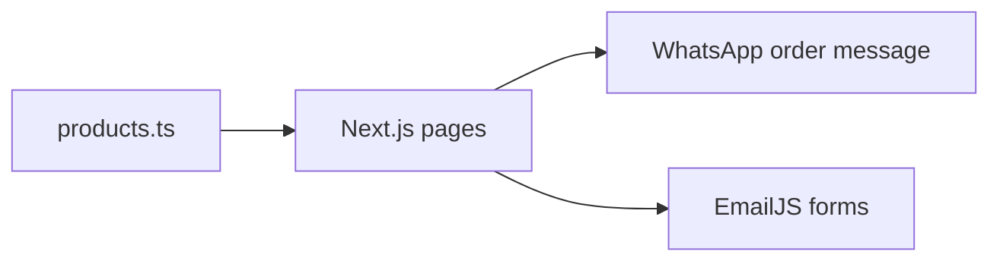

# Case study: TastEat Foods

## Overview
TastEat Foods is a food business in Abuja selling Nigerian classics like akara, pap, moi moi, masa, golden yam and yaji. I built its website so customers can browse the menu and order in a few taps.

## The problem
The business already took orders on WhatsApp. It needed a proper menu online that people could find on Google, without forcing customers or staff into a new ordering system.

## What I built
- A product catalogue with categories (Breakfast, Northern, Snacks and Sides, Spices) and a page for each product
- A WhatsApp order button that turns the chosen options and quantity into a ready written message
- A small menu assistant that answers questions about prices, ordering and contact, fully in the browser
- Contact and complaint forms through EmailJS, with a fallback to the visitor's email app
- SEO basics: metadata, sitemap, robots.txt, manifest and JSON-LD

## How it works
A Next.js App Router site in TypeScript. The menu lives in `src/data/products.ts` and business settings in `src/config/site.ts`, so product pages are generated from data. There is no database or server: orders go to WhatsApp and forms go to EmailJS.

## Challenges and how I solved them
- **Clean orders without a checkout.** The order button builds the message from the selected options, so staff get the same clear format every time.
- **Forms that never fail silently.** If EmailJS is not configured, the form opens the visitor's own email app instead.
- **Help without an AI bill.** The assistant is rule based, so it needs no API key and costs nothing to run.

## Outcome
The site is live and deploys automatically through Vercel on every push to main, with lint and build checks in GitHub Actions. <!-- add real metric: e.g. orders per week via the site -->

## Links
- Live: tasteatfoods.com
- Code: github.com/emmybest19/tasteat
